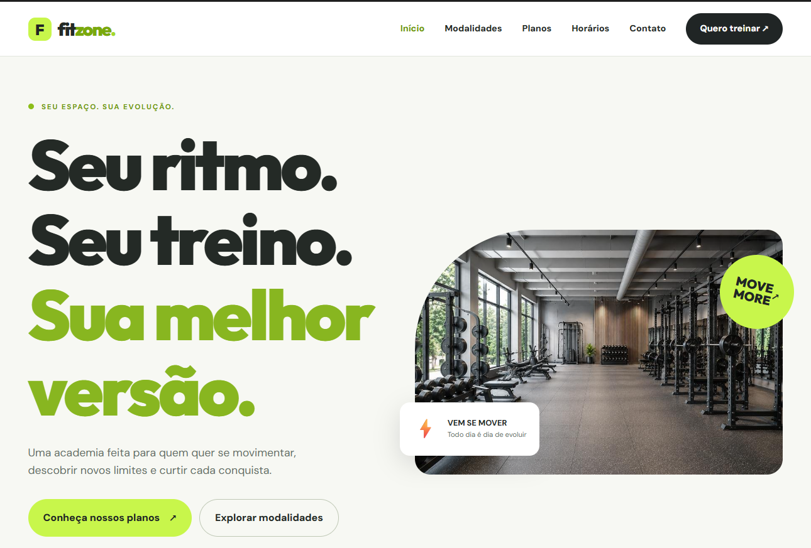
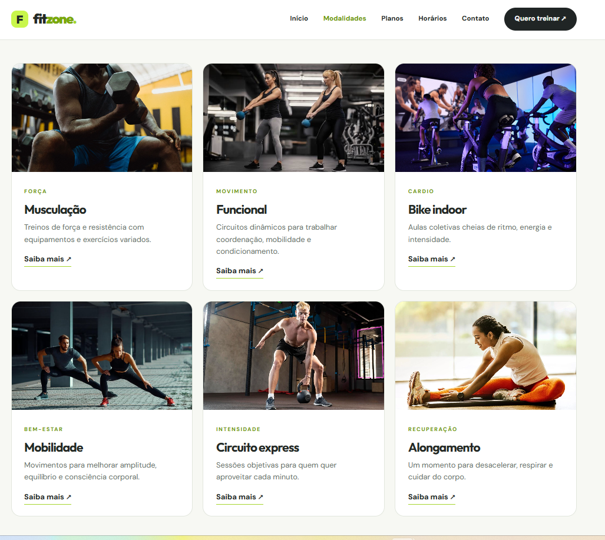
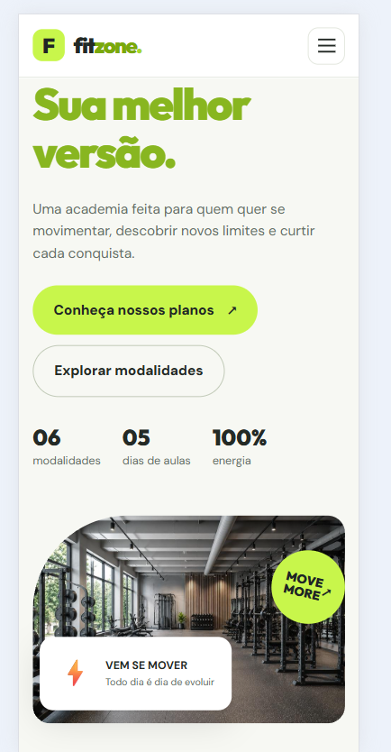
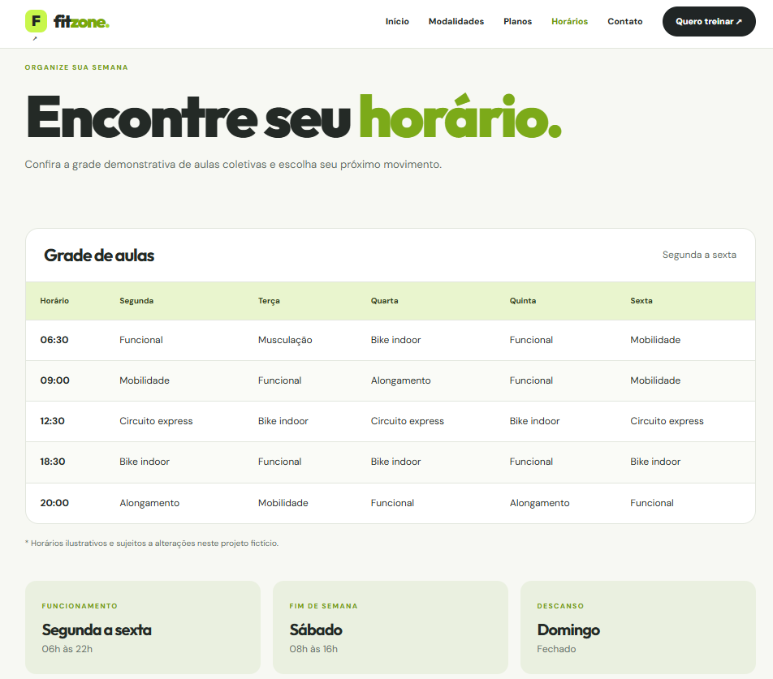
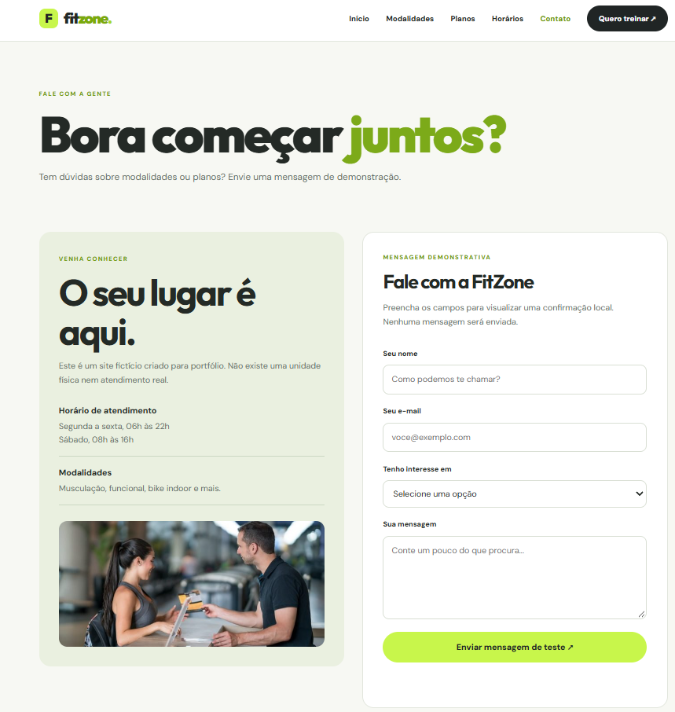
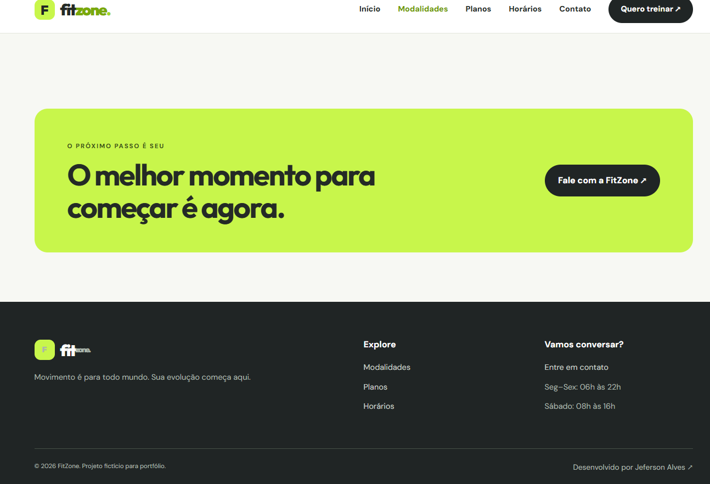

# FitZone ⚡

**Site institucional responsivo de uma academia fictícia**, desenvolvido com HTML, CSS e JavaScript. Apresenta cinco páginas interligadas, com identidade visual em branco, grafite e verde-limão.

## 🔗 Demonstração

O endereço do **GitHub Pages** será incluído após a primeira publicação.

## ✨ Funcionalidades

- Página inicial com apresentação e chamadas para ação
- Seis modalidades com fotografias armazenadas localmente
- Três planos demonstrativos com direcionamento para contato
- Grade semanal de aulas e horários de funcionamento
- Formulário com validação e confirmação local, sem envio de informações
- Menu responsivo para dispositivos móveis
- Navegação entre cinco páginas e crédito do desenvolvedor no rodapé

## 🛠️ Tecnologias

- **HTML5:** estrutura semântica e navegação multipágina
- **CSS3:** Grid, Flexbox e media queries
- **JavaScript:** menu mobile, seleção de planos e interação com formulário
- **Imagens locais:** fotografias na pasta `assets/images/`
- **Google Fonts:** tipografia carregada externamente, com fontes alternativas

## 📸 Capturas de tela

### Página inicial


### Modalidades


### Versão mobile


### Horários


### Contato


### Rodapé


## 🚀 Executar localmente

1. Clone este repositório ou baixe o ZIP.
2. Abra a pasta `FitZone` no VS Code.
3. Abra `index.html` no navegador ou utilize a extensão Live Server.

Não é necessário instalar dependências nem configurar backend.

## 📁 Estrutura

```text
FitZone/
├── assets/
│   └── images/          # Fotografias locais
├── screenshots/         # Capturas reais para README e portfólio
├── index.html
├── modalidades.html
├── planos.html
├── horarios.html
├── contato.html
├── styles.css
├── script.js
└── README.md
```

## ℹ️ Observações

Este é um **projeto fictício para portfólio**. Valores, planos, horários e serviços são ilustrativos. O formulário não envia mensagens e não realiza contratações.

As fotografias foram fornecidas para a montagem do projeto; **confirme as licenças de uso antes da publicação pública**.

## 👨‍💻 Autor

Desenvolvido por **Jeferson Alves** — [GitHub](https://github.com/JefersonAlvesrs).
